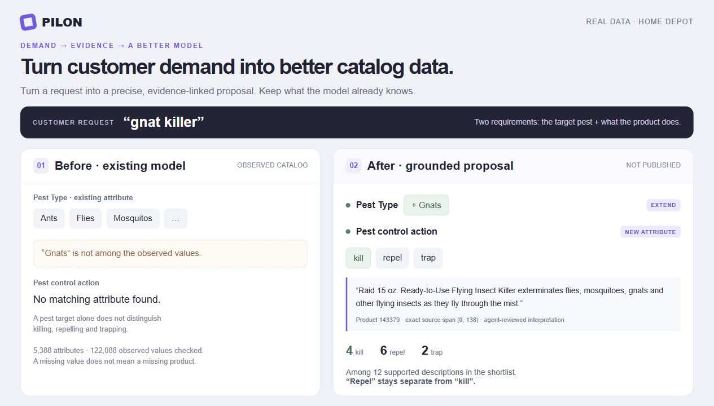

# PILON

**Find what customers ask for that your catalog cannot yet describe.**

PILON compares demand with your existing attributes **and values**, finds supporting product evidence, and proposes a precise model change.



*Illustrated from the real Home Depot run below. Proposed changes, not a published storefront. [Inspect the example and source evidence](docs/home-depot-example.md).*

## Start with the question you need to answer

| Your situation | Start here | What you get |
| --- | --- | --- |
| Customers ask for features your catalog may already describe under another name. | **Benchmark** your search or support requests against the full model and observed values. | Represented constraints, proposed attributes or values, and requests that need clarification. |
| You have a promising proposal but need product evidence. | Select proposals and supply product sources to **Extract**. | Exact evidence, proposed assignments, conflicts and unknowns. |
| You need a reviewable change for your catalog or search team. | Inspect the **Induct** projection. | A before/after model diff; publication remains an explicit step. |

PILON runs in the background. It helps teams investigate and maintain product knowledge; it does not answer shoppers or update a live storefront automatically.

## Background-loop quickstart

From a checkout with Python 3.11+:

```sh
python -m pip install -e .
pilon start --demo
```

Open the printed **http://127.0.0.1:8473/start** link. The bundled synthetic demo needs no model API key and makes no inference calls. Inspect its proposals, evidence and model diff. Installation may fetch packaging tools.

Use `pilon start` to open onboarding without creating a demo job. The guide and connector configuration downloads are read-only; opening them starts no model calls.

[**Five-minute guide: demo and your own files →**](docs/getting-started.md)

## Run semantic Benchmark on your own requests

Try the bundled synthetic model and four requests, then replace the input paths with your own model JSON and demand JSONL. The [getting-started guide](docs/getting-started.md#prepare-your-own-files) explains both formats.

```sh
pilon benchmark run --model src/pilon/facets/example/benchmark-model.json --signals src/pilon/facets/example/benchmark-requests.jsonl --config configs/openrouter.json --output-dir runtime/my-benchmark --db runtime/my-benchmark/jobs.sqlite
```

This is a **dry run by default**. Review the planned work and estimates before adding `--execute`. Execution uses the configured OpenRouter, OpenAI-compatible, or local Ollama endpoint and validates exact quotations and model references. It stops at Benchmark. Selected proposals move to Extract through `pilon loop enrich`.

Choose the provider, model, environment-variable name for credentials, and limits in JSON. The default request batch is bounded to 20 records. The complete model and observed values must fit the configured context; oversized context is rejected rather than silently shortened. Estimated spending guards use your configured rates and cannot guarantee a provider's final bill.

[**Configure a model and understand the guards →**](docs/model-connectors.md)

## How the pieces fit

```text
Model + demand exports
        ↓
Benchmark: interpret requests and compare the model
        ↓ explicit selection + product sources
Extract: verify source evidence
        ↓
Induct: inspect the proposed model and assignment diff
        ↓ explicit local publication
Versioned snapshot → your downstream integration
```

Model connections generate semantic reviews of new demand. Source connections supply demand and product evidence. These are separate responsibilities: a configured LLM does not connect your PIM, fetch product pages, or supply product facts.

| Available now | Integration still required |
| --- | --- |
| Configurable semantic model calls; dry runs, limits, review validation, caching and usage records | Your choice of model and evaluation on representative requests |
| CSV/JSONL exports, WANDS and Home Depot importers, local file watching | Direct authenticated CRM, search, PIM and CMS feeds |
| Lexical and FTS5 routing, supplied-vector hooks, exact annotation checks | BGE execution, LangExtract wrappers, OCR/vision and ANN integrations |
| SQLite jobs, checkpoints, review pages, local projection/publication/rollback | Writes to a live PIM, knowledge graph, search index or storefront |

[**Built-in tools, extension contracts and planned connectors →**](docs/tools-and-connectors.md)

## A real example: Home Depot

**1,000 distinct requests → 5,388 attributes + 122,088 observed values.**

| Benchmark found | Extract checked | Induct proposed |
| --- | --- | --- |
| 1,420 represented criteria; 9 attribute proposals; 43 value proposals; 562 criteria to clarify | 39 shortlisted descriptions from an index of 124,428; 22 products with supporting evidence | 3 new attributes, 1 value-domain extension, 34 evidence-linked assignments; 2 proposals without sufficient evidence retained |

Several criteria can come from one request. These are supplied agent decisions, with a targeted second pass on 102 requests, not independent accuracy or recall measurements. **The 1,000-request example replays detached decisions; it did not run through the new model connector.** Replay makes no inference API calls; the earlier agent work is separate.

Supply the source CSVs locally to reproduce it:

```sh
python scripts/replay_home_depot.py --input-dir /path/to/home-depot-csvs
```

[**Inputs, replay, evidence and limitations →**](docs/home-depot-example.md)

## Go further

- [Getting started](docs/getting-started.md): first run, input shapes, review and handoff.
- [Model connectors](docs/model-connectors.md): provider configuration, execution, limits and resume.
- [Tools and connectors](docs/tools-and-connectors.md): implementation inventory and source/extractor boundaries.
- [Background-loop contract](docs/background-loop-contract.md): job lifecycle, projection, publication and rollback.
- [Source record guide](docs/source-connectors.md) and [original Discovery walkthrough](docs/use-case-ecommerce-filter-discovery.md).
- [Contribution guide](CONTRIBUTING.md), [data handling](SECURITY.md), and [MIT license](LICENSE).

**Local alpha · v0.3.0a1.** Quotes establish where evidence came from; they do not prove a model's interpretation. Observed values do not establish product coverage. Review proposals and evaluate their usefulness before downstream publication. Reports retain source text and need the same access controls as their inputs.
