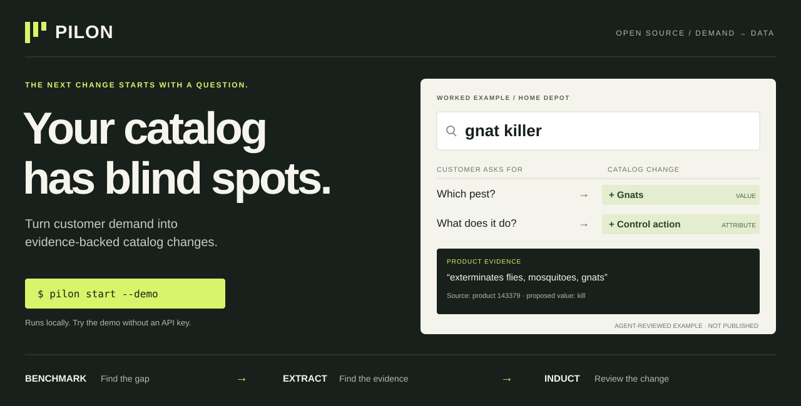
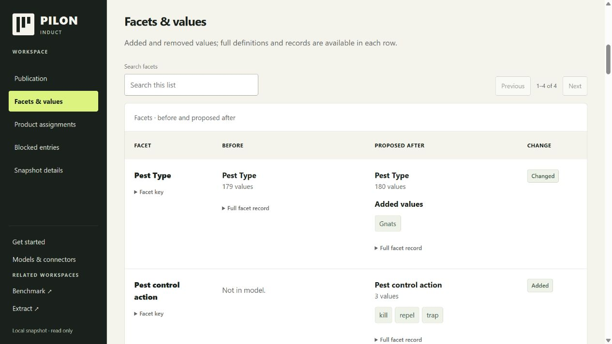

**Turn customer demand into a schema diff. Keep the evidence.**

Treat customer demand as a test of your catalog. PILON compares search and support requests with your existing attributes **and their values**, reuses what already covers the demand, and investigates gaps with product evidence. Catalog and search teams get a concrete change to review: new attributes, new values and the product assignments they support.

[**Try the demo**](#try-it-locally) · [**See the evidence**](docs/home-depot-example.md) · [**Bring your data**](docs/getting-started.md#prepare-your-own-files) · [**Contribute**](CONTRIBUTING.md)

## “gnat killer” is two requirements

In the recorded Home Depot example, the request asks for a target pest **and** an action. The catalog already has `Pest Type`; the missing pieces are more precise:

| Attribute | Existing model | Proposed change |
| --- | --- | --- |
| `Pest Type` | Present, but no observed `Gnats` value | Reuse the attribute; add `Gnats` |
| `Pest control action` | Absent | Add a separate attribute: `kill`, `repel`, `trap` |

Reviewed descriptions support **4 kill, 6 repel and 2 trap** assignments. Keeping the action separate preserves the distinction between a killer, a repellent and a trap. Each assignment links to its source evidence and scope.

[Inspect the recorded example →](docs/home-depot-example.md)

## Try it locally

With **Python 3.11+**, clone the repository and run from its root:

```sh
git clone https://github.com/jhuret1/pilon.git
cd pilon
pip install -e .
pilon start --demo
```

Open [**localhost:8473/start**](http://127.0.0.1:8473/start). Explore a proposal, its evidence and the proposed model diff. The bundled demo uses **synthetic data**, needs **no API key** and makes **no model calls**.

For your own requests, semantic Benchmark supports configurable **OpenRouter, OpenAI-compatible endpoints and local Ollama**. Preview a run before explicitly enabling inference.

[First-run guide →](docs/getting-started.md) · [Model setup →](docs/model-connectors.md)

## Three tools. Three separate decisions.

1. **Benchmark — Find what the model covers.** Compare demand with the full supplied model and observed values. Reuse covered attributes and values; surface missing ones and requests that need clarification.
2. **Extract — Check the product evidence.** Select proposals and supply product sources. Inspect exact quotations, proposed assignments, conflicts and unknowns.
3. **Induct — Review the change.** Inspect the before/after model, evidence-linked assignments and blocked proposals.

Benchmark stops at its review. You choose what moves to Extract. **Nothing is published automatically**; local publication is explicit, and connecting changes to your PIM or search index is a separate integration.



*Home Depot run · proposed changes in the Induct workspace · not published.*

## A recorded run, with evidence to inspect

**1,000 distinct Home Depot queries** compared with **5,388 attributes and 122,088 observed attribute/value pairs**.

- **Benchmark:** 1,420 represented criteria, 43 value gaps, 9 attribute gaps and 562 unresolved criteria.
- **Extract:** 39 shortlisted descriptions reviewed; 22 products with supporting evidence.
- **Induct:** 3 new attributes, 1 value-domain extension and 34 evidence-linked assignments proposed. Two proposals remained blocked.

These counts replay **supplied agent reviews**, including a targeted second pass on 102 queries. They are **not independent accuracy results or measurements of the model connectors**. One query can contain several criteria; retrieval recall was not measured.

[Results manifest →](docs/examples/home-depot-results.json) · [Reproduce with your local source CSVs →](docs/home-depot-example.md#reproduce-benchmark-and-replay-the-reviews)

## Build on it

- [**Getting started**](docs/getting-started.md) — demo, input formats and your first run.
- [**Model connectors**](docs/model-connectors.md) — providers, credentials, execution limits and resume.
- [**Tools and connectors**](docs/tools-and-connectors.md) — built-in capabilities, extension points and planned integrations.
- [**Source records**](docs/source-connectors.md) · [**Job lifecycle and publication**](docs/background-loop-contract.md).
- [**Contributing**](CONTRIBUTING.md) · [**Data handling**](SECURITY.md) · [**MIT license**](LICENSE).

**Local alpha · Python 3.11+ · MIT**
