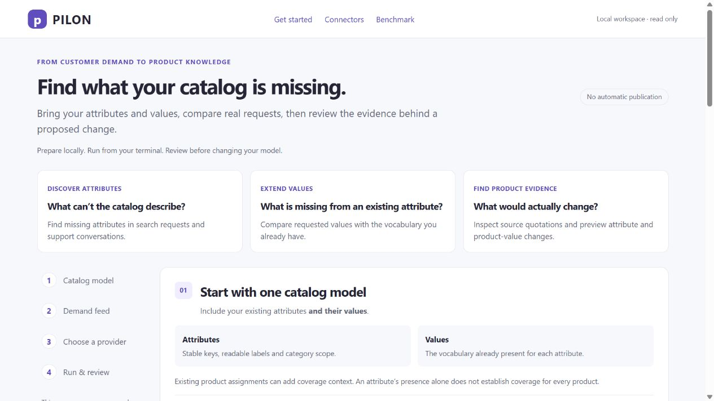

# Get started in five minutes

Start with a customer question: is the requested feature already represented, does the model need a new value or attribute, or is the request ambiguous? **Benchmark** produces that review. Add product evidence later through **Extract**, then inspect a model change in **Induct**.

## Open the local demo

Use Python 3.11+ and run from the repository root:

```sh
python -m pip install -e .
pilon start --demo
```

Open the printed **http://127.0.0.1:8473/start** link. The bundled example is synthetic and requires no model API key. Inspect a proposal, its source quotations, and the assignments that remain unknown or conflicted. The demo runs through projection and publishes nothing. Installation may fetch packaging tools; running the demo makes no inference calls.



Use `pilon start` without `--demo` to open onboarding without creating a demo job. `/connectors` offers configuration examples to download. These are read-only pages: they do not execute models, expose environment secrets, or publish changes. `--port` changes the local port and `--db` selects the workspace database.

For an uninstalled, offline checkout, the static HTML demo is also available:

```sh
python -m src.pilon loop demo
```

Open `runtime/background-loop.html`; its JSON counterpart is `runtime/background-loop.json`. Add `--new-source` and distinct `--html`/`--output` paths to save a second snapshot with evidence for a removable-insole assignment. Unsupported proposals remain visible.

## Preview a semantic run

The bundled [Benchmark model](../src/pilon/facets/example/benchmark-model.json) and [four requests](../src/pilon/facets/example/benchmark-requests.jsonl) are small synthetic inputs suitable for the model connector:

```sh
pilon benchmark run --model src/pilon/facets/example/benchmark-model.json --signals src/pilon/facets/example/benchmark-requests.jsonl --config configs/openrouter.json --output-dir runtime/my-benchmark --db runtime/my-benchmark/jobs.sqlite
```

The default is **dry run**: no model request is sent and no API key is needed for the preview. Inspect the planned work and estimates before deciding to execute. The example explicitly selects `runtime/my-benchmark/jobs.sqlite` so later commands can share that workspace. The complete schema and values must fit the configured context; oversized context is rejected rather than replaced by a lexical shortlist. The default run is bounded to 20 demand records; larger inputs require explicit partitioning.

Choose [OpenRouter](../configs/openrouter.json), [OpenAI-compatible](../configs/openai-compatible.json), or [local Ollama](../configs/local-ollama.json). Review the endpoint, model and limits before use. The [model connector guide](model-connectors.md) explains credential setup, cost estimates and resume.

## Prepare your own files

The input contract is a model JSON object and demand records in JSONL or CSV. CSV uses the same field names as column headers; use JSONL for nested data. Here is a minimal **synthetic** `model.json`, using the same schema-only contract as the bundled example:

```json
{
  "category": "running-shoes",
  "version": "example-v1",
  "synthetic": true,
  "assessment_scope": "schema_only",
  "observation_period": "unknown",
  "demand_unit": "sampled_queries",
  "categories": [],
  "facets": [
    {
      "key": "width",
      "label": "Width",
      "definition": "Overall shoe width, not space around the toes.",
      "values": ["standard", "wide"],
      "values_status": "observed_not_exhaustive"
    }
  ],
  "assignments": []
}
```

Save `requests.jsonl` with one JSON object per line, without an enclosing array:

```jsonl
{"id":"request-1","category":"running-shoes","role":"demand","source":"synthetic_example","text":"wide running shoes","count":1}
{"id":"request-2","category":"running-shoes","role":"demand","source":"synthetic_example","text":"running shoes with a removable insole","count":1}
```

Replace the synthetic data with your actual model and exported requests; remove the synthetic flag for real inputs. Keep full observed value domains, stable attribute keys, immutable record IDs and unchanged source text. `category` identifies the shared dataset/domain and must match between model and records. An empty `categories` array means no product taxonomy was supplied.

This example deliberately uses `schema_only` with an unknown observation period, so dates and product assignments are unnecessary. Each row is one sampled request, not a measured customer frequency. If you supply real event counts or dates, preserve their actual meaning. Schema-only review cannot establish product availability, per-product coverage, or live storefront filters. See the [record guide](source-connectors.md) for broader feeds.

Preview your files with the same command:

```sh
pilon benchmark run --model model.json --signals requests.jsonl --config configs/openrouter.json --output-dir runtime/my-own-benchmark --db runtime/my-own-benchmark/jobs.sqlite
```

## Execute, then review

For a hosted provider, set the environment variable named in the configuration; keep the actual key out of JSON and source control. For Ollama, prepare the local model and compatible endpoint separately. PILON does not download or start that service.

Add `--execute` only when ready to send model requests:

```sh
pilon benchmark run --model model.json --signals requests.jsonl --config configs/openrouter.json --output-dir runtime/my-own-benchmark --db runtime/my-own-benchmark/jobs.sqlite --execute
```

Execution validates quotation spans and references to your model. Invalid semantic claims become explicit unresolved items, with a validation count; transport or malformed-response failures stop the run. Validated reviews are cached for resume and assembled into a Benchmark result. Grounding checks do not establish semantic accuracy: inspect aliases, units, intended use and ambiguous wording. Rates in your configuration drive estimates, not a guaranteed billing cap.

Use the job ID printed by the command. For the own-files example above, open its database:

```sh
pilon start --db runtime/my-own-benchmark/jobs.sqlite
```

If you selected a different database, use that printed path instead. Open the returned Benchmark link. Review represented constraints, attribute/value proposals, and unresolved requests. Semantic execution stops at **Benchmark**; it does not extract product facts or publish a model.

## Investigate one proposal with product evidence

After reviewing a proposal, supply catalog sources from the same dataset. For the synthetic model above, a valid `product-sources.jsonl` example is:

```jsonl
{"id":"source-1","category":"running-shoes","role":"catalog","source":"synthetic_product_spec","product_id":"shoe-1","text":"Removable insole: yes"}
```

Replace the example with genuine product text. Demand expresses what people want; a catalog record supplies evidence about a product. `Label: value` text is supported by the local parser. Free text can carry supplied exact-span annotations or use a custom extractor; the configured Benchmark model is not automatically used for extraction.

Select the exact candidate key shown in Benchmark, then run the returned child job:

```sh
pilon loop enrich BENCHMARK_JOB --candidate CANDIDATE_KEY --signals product-sources.jsonl --db runtime/my-own-benchmark/jobs.sqlite
pilon loop work --job ENRICHMENT_JOB --once --db runtime/my-own-benchmark/jobs.sqlite
```

`enrich` prints the new `ENRICHMENT_JOB` identifier and the Extract/Induct links. It accepts reviewed proposals with an existing attribute key or a stable proposed key; unresolved intent needs clarification first. Repeat `--candidate` to select several. An optional routing manifest limits each target to selected source records. A shortlist does not establish full-catalog recall.

Inspect **Extract** for evidence, conflicts and unknowns, and **Induct** for the proposed schema and assignment diff. Publication is a separate local operation; no PIM or storefront is updated. See [tools and handoff](tools-and-connectors.md#select-proposals-explicitly) and the [publication contract](background-loop-contract.md).

## Choose your next path

| Goal | Guide |
| --- | --- |
| Configure a hosted or local model and control a small run | [Model connectors](model-connectors.md) |
| Reproduce the real 1,000-request Home Depot example without inference calls | [Home Depot replay](home-depot-example.md) |
| Map search, support or catalog exports; add an extractor | [Tools and connectors](tools-and-connectors.md), [source records](source-connectors.md) |
| Watch local exports, revisit evidence, publish or roll back locally | [Background-loop contract](background-loop-contract.md) |

The Home Depot example reattaches supplied agent decisions to local source CSVs. It does not demonstrate that the new provider connector processed those 1,000 requests, and its review counts are not an independent accuracy measurement.
