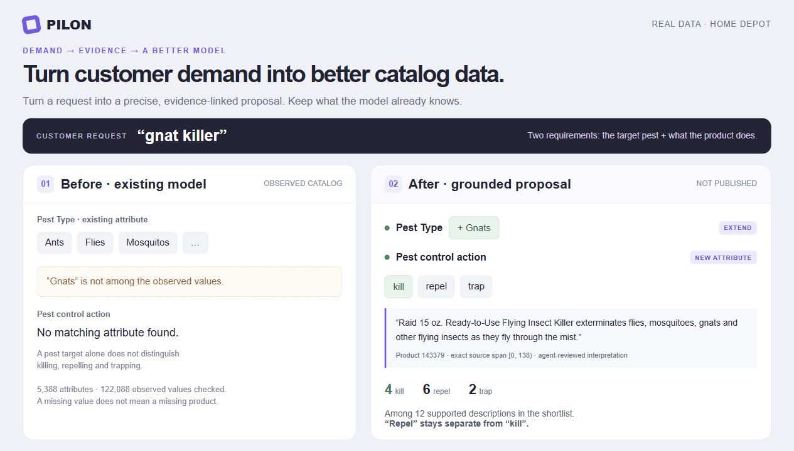

# Home Depot: local Benchmark → Extract → Induct

This example uses real, locally supplied data. It replays supplied agent decisions,
then tests selected proposals against product descriptions. The recorded run produced
**34 assignments on 22 products, three new fields and one extended field**. Two
proposals remain fully blocked, and the projection is **not published**. The
[results manifest](examples/home-depot-results.json) records the final metrics.
Replay bundles omit raw CSVs, descriptions and source quotations; readers supply
their own local CSVs.



Illustrated summary of the recorded results ([HTML source](assets/home-depot-before-after.html)).
Workspace screenshots: [Benchmark](assets/home-depot-benchmark.jpg),
[Extract](assets/home-depot-extract.jpg), [Induct](assets/home-depot-induct.jpg).

## Inputs and provenance

Use Python 3.11+, an installed checkout (`python -m pip install -e .`), and SQLite
with FTS5 support. Run the examples from the repository root. Obtain the files
separately from the [original Kaggle competition](https://www.kaggle.com/competitions/home-depot-product-search-relevance)
or the recorded [mirror at commit `39d6ca2959b0f9bacbef56e1e3f3807fb061bba6`](https://github.com/MohammedFCIS/Home-Depot-Product-Search-Relevance/tree/39d6ca2959b0f9bacbef56e1e3f3807fb061bba6/data),
and place the extracted CSVs in `runtime/home-depot/raw/`. PILON does not download
them. The recorded provenance is for local evaluation; redistribution permission
has not been verified.

Expected **uncompressed file** fingerprints, recorded in the local
`source-manifest.json` (local, not bundled):

| File | Bytes | SHA-256 |
| --- | ---: | --- |
| `train.csv` | 8,254,196 | `4a754892f569e565d91c73fd25fdc28cfb9ebd6777481228d008ae5a38244e2c` |
| `attributes.csv` | 102,414,462 | `1eebb94a5e64a3816c0f00cd0bb0338e456db3b51702bc0582f1e93d62fa605b` |
| `product_descriptions.csv` | 105,840,215 | `f5f8fc0ee992508a75ce4588c4855384abaaaf8e87c6210e3b01573250808328` |

The optional `source-manifest.json` contains a `files` array with `file`, `bytes`,
`sha256` and source `url`, plus the original source and mirror revision. The importer
checks the required input hashes; its output `manifest.json` records encodings,
sampling, source provenance and export hashes. URLs are declarations, not remote
authentication. See the [importer](../src/pilon/home_depot.py).

The recorded import contains **1,000 distinct, unchanged queries** sampled from
11,795 distinct `search_term` strings. Sampling sorts by SHA-256 of compact UTF-8
JSON `[seed, text]`, then text, using seed **`pilon-home-depot-v1`**. The full
structured model contains **5,388 fields and 122,088 observed field/value pairs**;
**589,915 `BulletNN` rows** are excluded as unstructured text. Neither relevance
scores nor query/product associations enter Benchmark. No product category taxonomy,
per-product coverage, query-frequency estimate or live storefront filters are
supplied. An observed value is not proof of coverage for a product or category.

## Reproduce Benchmark and replay the reviews

The [end-to-end replay helper](../scripts/replay_home_depot.py) provides a
one-command pipeline using local CSVs, the [detached decisions](examples/home-depot-decisions.json)
and [detached extraction evidence](examples/home-depot-evidence.json):

```sh
python scripts/replay_home_depot.py --input-dir runtime/home-depot/raw --output-dir runtime/home-depot/full-replay
```

It validates hashes and exact spans, runs Benchmark through Induct, and prints job
IDs and workspace URLs. To view that replay, run
`pilon loop serve --db runtime/home-depot/full-replay/replay.sqlite`. The following
steps expose the individual commands and routing API.

Start with the raw baseline, without semantic reviews:

```sh
pilon benchmark home-depot --input-dir runtime/home-depot/raw --output-dir runtime/home-depot/replay --db runtime/home-depot/example.sqlite --sample-size 1000 --seed pilon-home-depot-v1
```

The previously recorded raw baseline is `job_3b2ffdbd84f02c7cf76b` in
`runtime/demo-v3.sqlite`. Use the job ID printed by your own run: provenance and
other frozen inputs affect job identity. Choose a fresh output directory if source
files or manifest declarations change; stale cached imports are rejected.

Replay the [generated review bundle](examples/home-depot-decisions.json):

```sh
pilon benchmark home-depot --input-dir runtime/home-depot/raw --output-dir runtime/home-depot/replay --db runtime/home-depot/example.sqlite --sample-size 1000 --seed pilon-home-depot-v1 --reviews docs/examples/home-depot-decisions.json
pilon loop report REVIEWED_JOB --db runtime/home-depot/example.sqlite --output runtime/home-depot/reviewed-report.json
```

Replace `REVIEWED_JOB` with the returned ID. The command imports and runs Benchmark;
it does not run Extract automatically. The detached bundle contains generated
decisions, offsets and quote hashes. Replay reattaches exact quotations from the
reader's local data and validates model, records and spans. It does not regenerate
semantic judgments. See [CLI options](../src/pilon/home_depot_commands.py),
[bundle attachment](../src/pilon/loop/review_bundle.py) and
[review validation](../src/pilon/loop/semantic.py).

The decisions originate from an agent team with targeted agent re-review, **not
independent gold or an accuracy benchmark**. Replay makes **zero provider API calls**;
creating and reviewing those decisions consumed agent compute, and local replay
still consumes CPU, storage and time. Agent-session usage was not metered by PILON.

| Recorded Benchmark result | Count |
| --- | --- |
| Reviewed criteria across 1,000 requests | 2,034 |
| Represented criteria | 1,420 |
| Value gaps / attribute gaps / filter proposals | 43 / 9 / 0 |
| Unresolved criteria | 562 |
| Requests with at least one represented criterion | 821 |
| Requests with all criteria represented | 434 |
| Audited records | 102 |
| Audit findings | 30: 21 `corrected`, 9 `needs_review` |

The reviewed Benchmark job is `job_32a1cae15065657b9838`. These are criterion and
request counts, not grouped candidate counts or product-coverage measurements.
The recorded raw baseline took **24.55 s**, and semantic-review replay took
**0.63 s**. These are local run timings; they exclude agent review and are not
performance guarantees.

## Route descriptions and review their evidence

The built-in [description API](../src/pilon/home_depot_assets.py) is
`index_descriptions(csv_path, database, *, encoding='utf-8')` and
`route_assets(database, phrases, *, limit=30)`. Reproduce the five local shortlists:

```python
import json
from pathlib import Path
from pilon.home_depot_assets import index_descriptions, route_assets

root = Path('runtime/home-depot')
out = root / 'extract-replay'
out.mkdir(parents=True, exist_ok=True)
database = root / 'descriptions-replay.sqlite'
manifest = index_descriptions(root / 'raw/product_descriptions.csv', database)
groups = {
    'pest_gnats': (['gnats', 'gnat'], 20),
    'pet_damage': (['pet resistant', 'pet damage', 'pet screen', 'pet proof'], 8),
    'sign_message': (['open house'], 8),
    'door_plate_keyhole': (['without keyhole', 'keyhole cover', 'keyhole escutcheon',
                            'keyhole plate', 'without a keyhole'], 20),
    'water_lily': (['water lily', 'Nymphaea'], 20),
}
for name, (phrases, limit) in groups.items():
    records, routing = route_assets(database, phrases, limit=limit)
    (out / f'{name}.json').write_text(
        json.dumps({'records': records, 'routing': routing}, ensure_ascii=False),
        encoding='utf-8')
```

The recorded index contains **124,428 description assets**. FTS5 searches the OR of
quoted phrases and BM25 ranks matching descriptions. Packets preserve full text,
IDs and hashes, and report selected/unassessed counts and
`selection_recall: "not_measured"`. Ranking is source selection, not fact validation;
unselected assets remain unassessed.

Read every selected text and retain every original record field. Add an explicit
`extractions` array of `{label, value, quote, start, end}`; offsets are Python
characters with an exclusive end. Use `[]` for rejected evidence. Reproducing the
semantic assignments requires the reviewed annotations or a fresh review; the
index and parser do not produce these judgments automatically.

| Source group | Selected | Accepted | Rejected | Product/fact assignments |
| --- | ---: | ---: | ---: | ---: |
| Gnats: pest target plus control action | 20 | 12 | 8 | 24 |
| Pet damage resistance | 8 | 8 | 0 | 8 |
| Sign message | 3 | 2 | 1 | 2 |
| Door-plate keyhole presence | 5 | 0 | 5 | 0 |
| Water-lily botanical name | 3 | 0 | 3 | 0 |
| **Total** | **39** | **22** | **17** | **34** |

The gnat group distinguishes **4 kill, 6 repel and 2 trap** descriptions. Preserve
fungus-gnat larval scope in the full proof; repellents and traps are not all matches
for “killer.” Insect meshes are rejected for these pest-control facts, while explicit
pet-damage claims on screens support the separate pet-resistance candidate. Corbel
keyhole mounting plates do not establish door-plate properties. Water-lily common
names alone do not establish a scientific `Botanical Name`; scientific names of
other plants in a mixed collection cannot be transferred to the lilies.

## Explicit handoff and proposed model changes

Save the 39 reviewed catalog records as local `annotated-all-sources.jsonl`. Build
`routing-by-target.json` from the packet routing objects, keyed by each existing
`fact_key` or new `proposed_key`; reuse the gnat manifest for both its targets.
Select the six exact candidate keys from `reviewed-report.json` →
`benchmark.candidates` (five source groups support six model targets):

```sh
pilon loop enrich REVIEWED_JOB --db runtime/home-depot/example.sqlite --candidate GNATS_KEY --candidate ACTION_KEY --candidate PET_KEY --candidate SIGN_KEY --candidate DOOR_KEY --candidate LILY_KEY --signals runtime/home-depot/extract-replay/annotated-all-sources.jsonl --routing runtime/home-depot/extract-replay/routing-by-target.json
pilon loop work --db runtime/home-depot/example.sqlite --job ENRICHMENT_JOB --once
pilon loop report ENRICHMENT_JOB --db runtime/home-depot/example.sqlite --output runtime/home-depot/enrichment-report.json
pilon loop serve --db runtime/home-depot/example.sqlite
```

Replace uppercase job/candidate placeholders with returned IDs and exact report
keys. The [handoff](../src/pilon/loop/enrichment.py) requires a completed Benchmark,
resolved proposals, stable targets and same-dataset catalog records. Its Python
signature is `prepare_enrichment(queue, benchmark_job, candidate_keys,
catalog_records, *, routing=None)`. It freezes a child job and retains parent/demand
provenance. Extraction is exhaustive only within the supplied per-target shortlist.

| Target | Before | Recorded projection |
| --- | --- | --- |
| Existing `Pest Type` | No observed `Gnats` value | Add `Gnats`; 12 product assignments |
| `Pest control action` (`pest_control_action`) | No pest-action field; generic `Control Type` describes device controls | New field: `kill`, `repel`, `trap`; 12 assignments |
| `Pet damage resistance` (`pet_damage_resistant`) | No corresponding field | New field: `Yes`; 8 assignments |
| `Sign message` (`sign_message`) | No corresponding field | New field: `Open House`; 2 assignments |
| Door-plate keyhole presence | Proposed field lacks suitable evidence | **Blocked**; corbel hardware is outside scope |
| Water-lily `Botanical Name` value | Scientific identity not explicitly sourced | **Blocked**; no inferred scientific name |

The Extract/Induct job is `job_4c1860e5cabf743edcf7`: **three new fields, one
existing-field value extension and 34 assignments on 22 products**. There are
**two fully blocked proposals** and **27 blocked entries** overall; the latter
also include unknowns for individual products. The recorded extraction replay
took **2.08 s**, excluding agent review. Selection recall remains unmeasured.
The final model hash and projection ID are in the
[results manifest](examples/home-depot-results.json).

Open **`/extract/ENRICHMENT_JOB`** for routing, source proofs and extraction results,
and **`/induct/ENRICHMENT_JOB`** for before/after schema and assignment changes.
These are separate read-only [workspaces](../src/pilon/loop/workspace.py) on
`http://127.0.0.1:8473`. **Induct** is model projection, formerly called **Ingest**.
No page or enrichment job automatically publishes a model or changes live filters;
explicit local publication remains a separate command. See
[tools and connector boundaries](tools-and-connectors.md) and
[projection implementation](../src/pilon/loop/projection.py).
