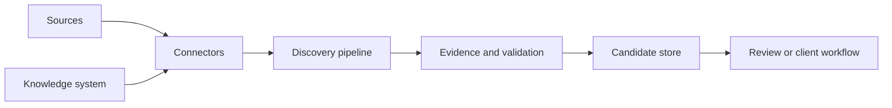

# Product direction (design proposal)

> **Discover what people need — and what your data can prove.**

PILON is an evidence-first knowledge discovery engine. It connects to an existing
knowledge graph, semantic model, ontology, or business schema; scans new content;
and proposes missing facts, emerging relations, contradictions, and model gaps.

Every proposal includes the sources, methods, comparisons, and validation steps
that produced it. PILON never writes to the canonical knowledge base by default.

For ecommerce, that becomes a concrete promise:

> **Reveal what shoppers care about — and which products truly match.**
>
> PILON connects search demand with product evidence to discover new filters,
> enrich the catalog, and explain every recommendation.

> [!IMPORTANT]
> This design describes the longer-term platform. The [current README](../README.md)
> covers the implemented commerce pipeline, supported inputs and runnable commands.

## Why PILON?

Most knowledge systems are good at storing what an organization already knows.
PILON focuses on the information that remains unexplained.

| Discovery | Question |
| --- | --- |
| Missing fact | Is a fact supported by the sources but absent from the graph? |
| Emerging relation | Does the same relationship appear independently across sources? |
| Contradiction | Do current sources disagree with a known fact? |
| Temporal change | Was a fact true before, but no longer true now? |
| Model gap | Is a recurring phenomenon impossible to express with the current model? |

PILON is designed to sit beside systems such as Neo4j, Stardog, GraphDB,
OpenMetadata, ServiceNow, Palantir, or an internal knowledge platform. It can also
run from files for local evaluation.

## One pipeline, several levels of precision

Start cheaply, then spend computation only where the signal justifies it.

```text
rules / statistics / TDA
          ↓ interesting regions only
embeddings / clustering / small models
          ↓ credible candidates only
structured extraction
          ↓ important candidates only
exact grounding / validation / human review
```

PILON ships execution profiles rather than forcing one model stack:

| Profile | Intended use | Typical methods |
| --- | --- | --- |
| `explore` | Scan a large corpus economically | Rules, graph analytics, embeddings, TDA |
| `balanced` | Continuous discovery | Lightweight extraction, targeted LLM calls, validation |
| `auditable` | High-value or regulated decisions | Exact spans, multi-source checks, constraints, review |

## Target quickstart

The target developer experience is deliberately small:

```bash
python -m pip install -e .
pilon demo ecommerce-facets
```

The demo opens a local workspace and runs one complete scenario:

1. load an existing category tree, facet schema, and product graph;
2. read new product feeds, search demand, and catalog signals;
3. detect a recurring product attribute that current filters cannot express;
4. extract and ground the strongest product-level evidence;
5. estimate catalog coverage and distinguish the candidate from existing facets;
6. propose a reviewable filter without changing the live storefront.

For an existing system, the target CLI is:

```bash
pilon discover \
  --knowledge neo4j://localhost:7687 \
  --sources ./catalog-signals \
  --profile balanced \
  --output ./pilon-candidates.jsonl
```

See the [runnable ecommerce filter example](use-case-ecommerce-filter-discovery.md).

## A discovery is more than a model response

```json
{
  "kind": "facet_candidate",
  "hypothesis": {
    "category": "running-shoes",
    "facet": "toe_box_shape",
    "values": ["wide", "standard", "tapered"]
  },
  "support": {
    "monthly_searches": 4860,
    "candidate_products": 317,
    "exactly_grounded_products": 204
  },
  "knowledge_check": {
    "duplicate_of_existing_facet": false,
    "closest_existing_facet": "width",
    "distinction_supported": true
  },
  "guarantees": {
    "exact_grounding": true,
    "multi_source": true,
    "human_reviewed": false
  },
  "status": "candidate"
}
```

The guarantees are explicit. A cheap topological signal and a human-reviewed,
source-grounded claim can coexist without pretending to have the same precision.

## Bring your own stack

PILON owns the discovery lifecycle, not every underlying technology.



| Extension point | Possible implementations |
| --- | --- |
| Sources | Files, S3, SharePoint, Kafka, APIs, databases |
| Knowledge systems | RDF/SPARQL, Neo4j, OpenMetadata, ServiceNow, custom APIs |
| Signal detectors | Rules, graph analytics, TDA, clustering, anomaly detection |
| Extractors | GLiNER, spaCy, local models, hosted LLMs, internal models |
| Grounders | LangExtract, deterministic span matchers, client implementations |
| Resolvers | Splink, deterministic IDs, embeddings, master-data services |
| Validators | SHACL, OWL, JSON Schema, rules, model consensus |
| Workflow | PILON review, webhook, Jira, ServiceNow, client queue |
| Observability | OpenTelemetry, Prometheus, Langfuse, client telemetry |

Plugins declare their operational properties and guarantees: supported inputs,
local or remote execution, expected cost, determinism, exact grounding, and data
egress. The policy engine selects a route from the run profile and the client's
constraints.

## Principles

- **Existing knowledge first.** PILON starts by asking what is already known.
- **Evidence before confidence.** Scores never replace inspectable sources.
- **Read-only by default.** Discovery and publication are separate decisions.
- **Progressive precision.** Expensive methods run only on useful candidates.
- **Plural infrastructure.** Ontologies are powerful, but not required terminology.
- **Open contracts.** Sources, models, stores, and validators remain replaceable.
- **Abstention is a result.** PILON can report that evidence is insufficient.

## What PILON is not

PILON is not another graph database, vector store, document management system, or
general-purpose GraphRAG framework. Those systems can be inputs and outputs. PILON
coordinates discovery across them and keeps the resulting hypotheses inspectable.

## Project status

PILON is a research alpha. The immediate work is to validate the discovery contract
on reproducible datasets before claiming production accuracy.

The first public milestone targets:

- a generic document and knowledge contract;
- file and Neo4j adapters;
- `explore`, `balanced`, and `auditable` profiles;
- exact evidence spans for promoted candidates;
- a read-only candidate review workspace;
- a benchmark based on hidden known facts and chronological discovery;
- one reproducible ecommerce facet-discovery demo.

## Community

Useful contributions include:

- a connector to a knowledge platform;
- a discovery or validation plugin;
- an evaluation dataset with clear licensing;
- a reproducible failure case;
- improvements to provenance, calibration, or review workflows.

Read the proposed [repository structure](vnext-repository-structure.md) before
adding a new subsystem. Small plugins and measured improvements are preferred over
new framework layers.

## License

PILON code and original fixtures are MIT licensed. Models, datasets, connectors,
and optional dependencies retain their own licenses and usage conditions.
